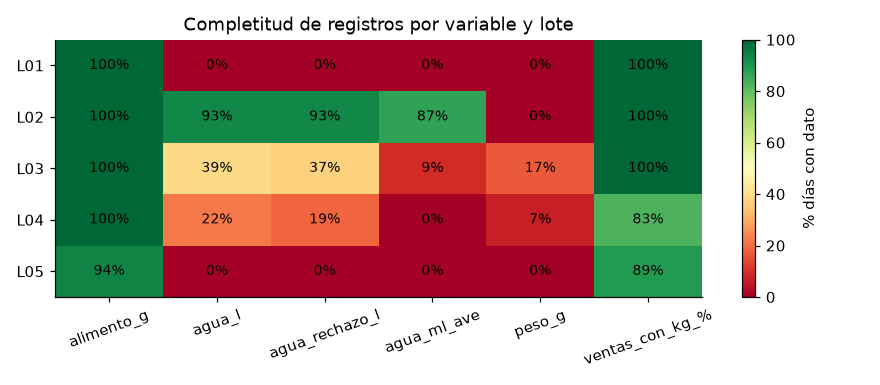
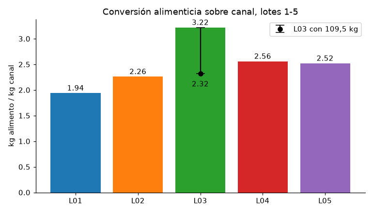
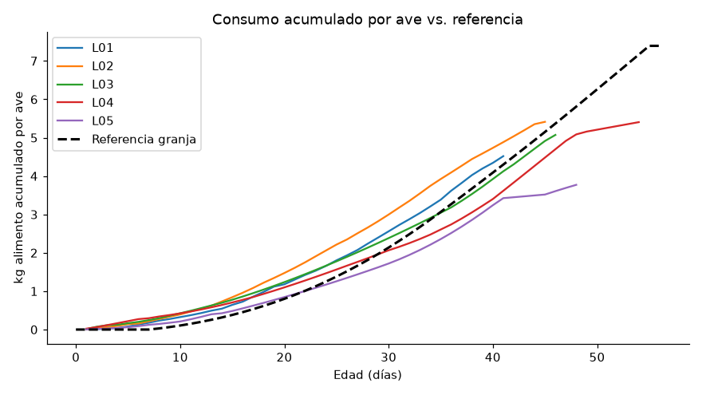
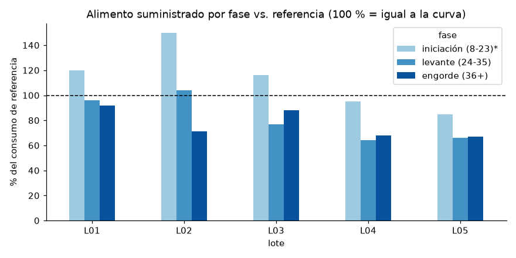
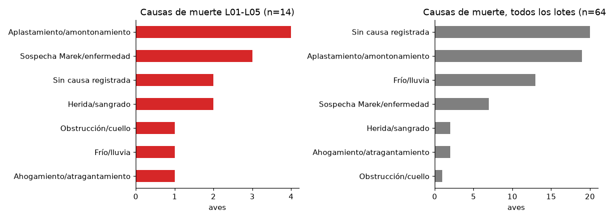
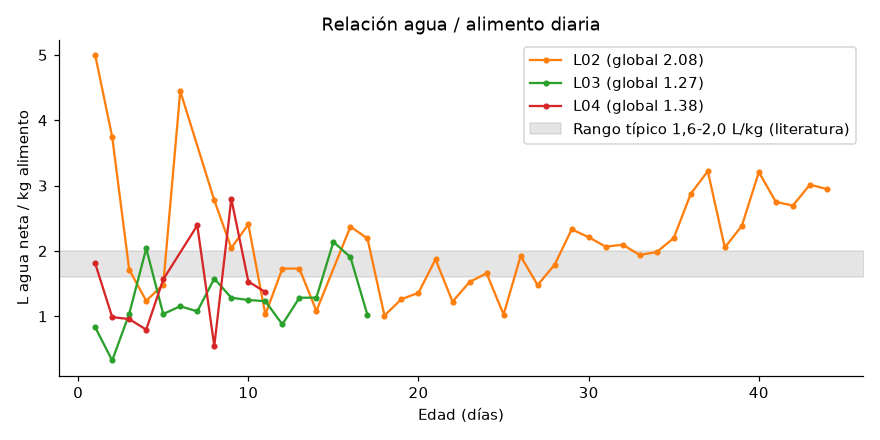
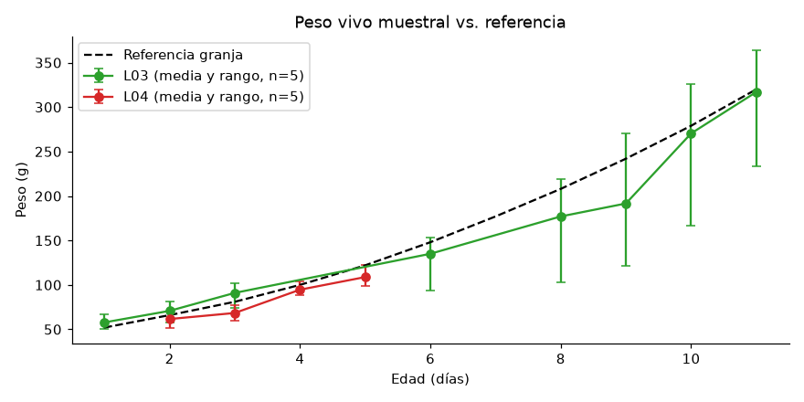

# Producción de pollos de engorde en una granja pequeña: eficiencia, mortalidad y calidad de datos

**Monterrey, Casanare (Colombia) · 17 lotes · 943 aves · enero–septiembre 2021**
Análisis detallado de los lotes **L01–L05** (264 aves, enero–mayo 2021), con Python (pandas, matplotlib).

## 1. Problema
Una granja familiar de pollo broiler llevaba sus registros en una hoja de cálculo con más de 30 pestañas. Preguntas:
1. ¿Qué tan eficiente fue el alimento (conversión) en cada lote?
2. ¿El alimento suministrado siguió la curva de referencia por fase (iniciación, levante, engorde)?
3. ¿Por qué murieron las aves?
4. ¿Hubo margen después de pagar alimento y pollitos?
5. ¿Los datos alcanzan para responder lo anterior? ¿Qué habría que registrar distinto?

## 2. Datos
| Fuente | Contenido |
|---|---|
| Libro principal de registros (33 pestañas) | alimento diario por lote, agua, mortalidad con causa, ventas |
| Copia de registros hasta el 27-mar-2021 | pesos individuales de los lotes 3 y 4 (5 aves por día, días 1–11) |
| Pestaña `AnexoPesoLote1` | curva de referencia de peso y consumo que usaba la granja (`data/referencia_granja.csv`) |

Los archivos originales de la granja son privados y **no se publican**; el repositorio incluye solo los datos ya limpios en `data/`. La limpieza (`src/limpieza_pollos.py`) produce una **tabla larga** (`fecha, lote, edad_dias, variable, valor, unidad, fuente_pestana, flag`) de 2.486 filas, un resumen por lote, un diccionario de datos y un log de limpieza. Los valores sospechosos **no se borran: se marcan**.

## 3. Método
- Conversión = kg de alimento suministrado / kg de **canal (carne limpia) vendida**. No es peso vivo, así que no es comparable 1:1 con el estándar Ross/Cobb (~1,6–1,8 sobre peso vivo).
- Consumo por ave = alimento suministrado / aves iniciales. Fases según la granja: iniciación 1–23, levante 24–35 y engorde 36+. La referencia no trae consumo para los días 1–7, así que la iniciación se compara en los días 8–23.
- Agua neta = suministrada − rechazada, solo en días con dato de agua y de alimento.
- Margen bruto **(estimado)**: los supuestos de precio salen de anotaciones sueltas de la hoja.

## 4. Hallazgos (lotes 1–5)
**Conversión alimenticia sobre canal**

| Lote | Aves | Vendidas | kg canal | kg alimento | Conversión | kg canal/ave |
|---|---|---|---|---|---|---|
| L01 | 50 | 48 | 116,7 | 226,0 | **1,94** | 2,43 |
| L02 | 51 | 49 | 122,0 | 276,1 | 2,26 | 2,49 |
| L03 | 50 | 36 | 78,9 – 109,5* | 253,6 | **2,32 – 3,22*** | 2,19 |
| L04 | 61 | 63 | 128,9 | 329,7 | 2,56 | 2,05 |
| L05 | 51 | 40 | 76,4 | 192,3 | 2,52 | 1,91 |

\*L03 tiene dos cifras de kg vendidos en las fuentes: la hoja de ventas suma 78,86 kg y el resumen de la granja dice 109,52 kg. Se reporta como rango de sensibilidad.

- **El primer lote fue el más eficiente** (1,94) y el que dio el pollo más pesado (2,43 kg de canal por ave). L04 y L05 terminaron con aves más livianas (2,05 y 1,91 kg) y peor conversión.
- **Consumo vs. referencia:** en iniciación (días 8–23) se suministró **más** alimento que la curva: L01 120 %, L02 150 %, L03 116 %. En levante y engorde, los lotes 3 a 5 quedaron en **64–88 %** de la referencia. Como se registró lo *servido* y no lo *consumido*, el exceso en iniciación probablemente es desperdicio. La bitácora del lote 3 menciona "bastante alimento regado".
- **Peso (lotes 3 y 4):** en los días 1–3 el L03 estuvo por encima de la referencia (107–112 %). Entre los días 6 y 9 cayó a 79–91 % y en los días 10–11 se recuperó (97–99 %). El L04 estuvo entre 84 y 95 % los días 2–5. La muestra es pequeña (n=5 por día y aves distintas cada día).
- **Mortalidad:** 14 aves de 264 (**5,3 %**). Va en aumento: L01 2 %, L02 3,9 %, L03 8 % y L04 9,8 %, y vuelve a bajar en L05 (2 %). La causa principal es **manejo**: aplastamiento o amontonamiento (4), heridas (2), ahogamiento y obstrucción (2) y frío (1). Hay 3 casos con sospecha de enfermedad. En todos los lotes (64 muertes) los peores eventos fueron las estampidas por cortes de luz y el frío de junio de 2021 en el lote 12.
- **Agua / alimento:** L02 = **2,1 L/kg** (42 días con dato), en línea con lo esperado. L03 (1,3) y L04 (1,4) tienen muy pocos días registrados para concluir algo.
- **Ingresos y margen (estimado):** L01–L05 vendieron **4.299.628 COP**, a un precio promedio que subió de 7.184 a 9.253 COP/kg. Suponiendo alimento a 2.425–2.758 COP/kg y pollito a 2.200 COP, el margen bruto conjunto sale entre **197.000 y 622.000 COP**, es decir 750–2.360 COP por ave inicial. Eso sin contar mano de obra, viruta, medicamentos ni energía. El **L03 sale con margen negativo** (−179.000 a −94.000 COP) con los kg de la hoja de ventas. **El alimento es ~70–80 % de los ingresos**: la conversión decide si el negocio da o no da.

## 5. Calidad de datos (también es un hallazgo)
- **Balance de aves:** solo **3 de 17 lotes cuadran** (iniciales = muertes + desaparecidas + vendidas). Por ejemplo, en L03 faltan 10 aves, en L08 19 y en L11 28. En L04 se "vendieron" 8 aves más de las que había. Los lotes 12–15 se vendieron combinados.
- **Ventas sin kg:** 30 de 89 registros de venta (34 %), que suman 189 de 776 aves vendidas, no tienen peso. Eso infla la conversión de los lotes 6 a 17, y por eso no se analizan.
- **Mortalidad:** 16 de 64 eventos (25 %) no tienen fecha (lotes 13–15, del 22-jun al 12-jul-2021) y 20 no tienen causa.
- **Completitud L01–L05:** el alimento está al 94–100 %. El agua va del 0 % (L01, L05) al 93 % (L02). Hay peso diario solo para L03 y L04, en 17 % y 7 % de los días. No hay temperatura numérica.
- Además: 57 fechas escritas como texto, unidades mezcladas (g, kg, bultos, libras) y lotes combinados en las ventas.



## 6. Recomendaciones
**Producción**
1. Medir el alimento **sobrante** además del servido y ajustar la ración de iniciación, donde se sirvió entre 16 y 50 % de más en L01–L03.
2. Reducir el aplastamiento: más comederos y bebederos, criadora o fuente de calor de respaldo para cortes de luz, y cortinas para las noches frías.
3. Fijar un peso objetivo de venta (~2,4 kg de canal, como L01) y vender por lote completo.

**Formato mínimo diario (una fila por lote y día)**
`fecha | lote | aves_vivas | alimento_servido_kg | alimento_sobrante_kg | agua_servida_L | agua_sobrante_L | muertes | causa (lista) | vendidas | kg_vendidos | valor_COP | temp_min | temp_max | observación`
Reglas: fecha siempre en formato fecha; **toda venta con kg y unidades**; pesar 10 aves cada 7 días; cerrar cada lote con el balance de aves; registrar las compras con precio; no mezclar lotes en una venta.

## 7. Gráficos
| | |
|---|---|
|  |  |
|  |  |
|  |  |

## 8. Cómo reproducir
```bash
git clone https://github.com/alejandro94ud/analisis-pollos-broiler.git && cd analisis-pollos-broiler
python -m venv .venv && .venv/bin/pip install -r requirements.txt
# Análisis (usa los datos limpios de data/)
.venv/bin/jupyter nbconvert --to notebook --execute analisis_pollos.ipynb
# Regenerar el notebook desde el script:  .venv/bin/python src/construir_notebook.py
# La limpieza (src/limpieza_pollos.py) requiere los originales privados en raw/, no incluidos.
```

```
├── README.md
├── analisis_pollos.ipynb      # análisis ejecutado
├── data/                      # datos limpios (tabla larga, resumen, diccionario, log) + referencia
├── graficos/                  # 7 gráficos PNG
└── src/                       # limpieza_pollos.py, construir_notebook.py
```

*Limitaciones: la conversión es sobre canal; el consumo es lo servido y no lo consumido; el margen es estimado; hay 2 fuentes en conflicto para los kg de L03. Las causas de muerte se publican categorizadas (no el texto libre de la bitácora).*

## Sobre mí
**Daniel Alejandro Barreto Guerrero**, Ingeniero Industrial.

## ¿Trabajamos juntos?
¿Tienes una granja o un negocio con registros en cuadernos o en Excel? Ofrezco la plantilla de registro diario lista para usar, con su dashboard, y el servicio de análisis de tus datos para encontrar dónde se pierde la plata.

👉 Escríbeme por [LinkedIn](https://www.linkedin.com/in/alejandro-barreto-datos/)
